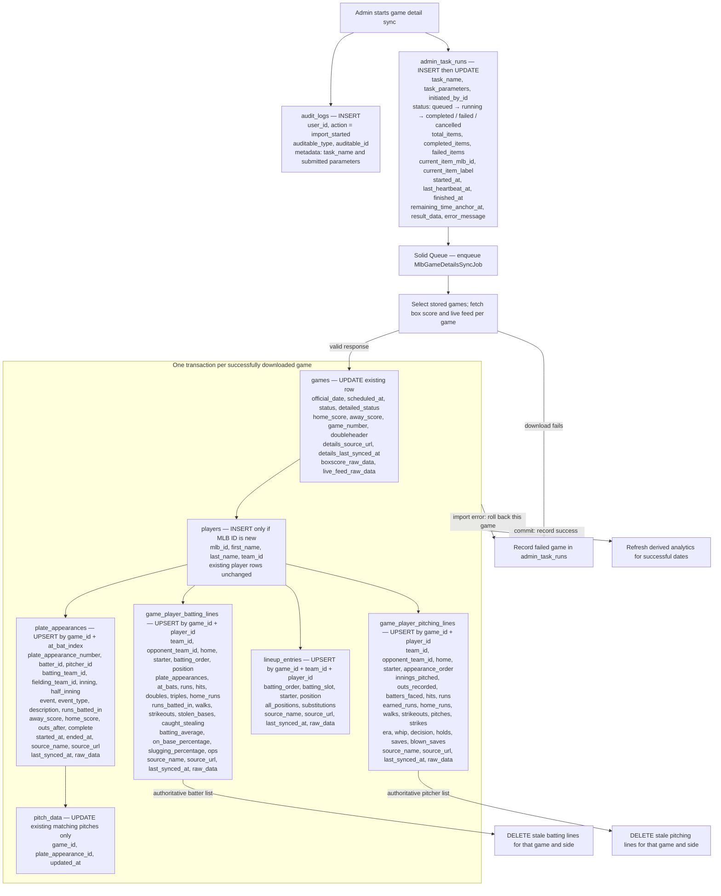
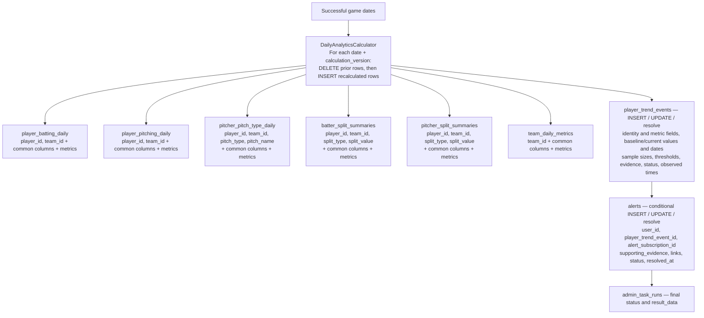

# Admin task: MLB game detail synchronization

`mlb_game_details_sync` selects **existing** games by MLB game ID or by an inclusive official-date range. A date-range run excludes cancelled games and unplayed conditional postseason games. It downloads a box score and live feed for each selected game. A game must already exist in `games`; this task does not create a game or schedule.

## Direct game-detail writes

The importer updates each selected `games` row with live-feed status, timing, scores, and raw responses. Missing live-feed values usually preserve the prior schedule values for dates, scores, game number, and doubleheader flag. The `games` schedule and team links are unchanged.

Players are created from box-score participants and plate-appearance batter/pitcher identities when absent. Existing `players` rows are not refreshed. Batting and pitching lines are deleted when the newer box score supplies an authoritative `batters` or `pitchers` ID list that omits them. `lineup_entries` and `plate_appearances` are upserted but not pruned when missing from a later response. Existing `pitch_data` rows are linked by `game_pk` and `at_bat_number`; pitch values are not downloaded or replaced here.

All direct writes for one game are in one transaction. A failed game does not roll back other games in the batch. Rails also sets `created_at` on inserted rows and refreshes `updated_at` for changed rows.

## Automatic downstream writes

After the game workers finish, the task calls `DailyAnalyticsRefresh` for the distinct official dates of **successfully** synchronized games. This is a separate stage; analytics failure does not undo the game-detail imports. No analytics refresh runs if no game synced successfully.

The six summary tables share these populated columns: `metric_date`, `source_start_date`, `source_end_date`, `sample_size`, `calculation_version`, `calculated_at`, `source_name`, `metrics`, `created_at`, and `updated_at`. The table-specific identity columns are shown in the diagram. Their `metrics` JSON contains the calculated statistics. The refresh replaces rows for each successful date and calculation version, including deleting prior rows when the new calculation produces none.

Trend-event refresh looks up players represented in stored `pitch_data` on those dates. It can create, update, or resolve `player_trend_events`; matching alert subscriptions can cause `alerts` inserts or evidence/link updates, and resolving a trend can resolve its alerts. These writes are conditional on trend detection and subscriptions. This game-detail task calls analytics with `refresh_contextual_benchmarks: false`, so it does not run the contextual benchmark refresh.

| Conditional table | Columns populated or changed |
| --- | --- |
| `player_trend_events` | On creation: `player_id`, `identity_key`, `event_type`, `role`, `metric_key`, `pitch_type`, `direction`, `severity`, `status`, `unit`, `baseline_value`, `current_value`, `change_value`, `threshold_value`, `baseline_sample_size`, `sample_size`, `baseline_start_date`, `baseline_end_date`, `current_start_date`, `current_end_date`, `onset_date`, `detected_at`, `last_observed_at`, `calculation_version`, `thresholds`, `supporting_pitches`, `metadata`. Existing active events refresh candidate fields and `last_observed_at`; resolution changes `status`, `resolved_at`, and `last_observed_at`. |
| `alerts` | For matching subscriptions, a new row gets `user_id`, `player_trend_event_id`, `alert_subscription_id`, `supporting_evidence`, `links`, and default `status = active`. Existing rows can update `alert_subscription_id`, `supporting_evidence`, and `links`. Trend resolution changes `status` to `resolved` and sets `resolved_at`. |

The Admin launch also inserts an `audit_logs` entry and uses Solid Queue tables to process the job. `admin_task_runs` tracks progress per game and stores the final counts, errors, and analytics result. The task clears the home snapshot cache after at least one game sync; that cache operation is outside the database writes shown here.

## Code references

- Admin launch and tracking: `app/controllers/api/admin/tasks_controller.rb`, `app/services/mlb_game_details_task_launcher.rb`, `app/jobs/mlb_game_details_sync_job.rb`, `app/services/mlb_game_details_progress_tracker.rb`
- Game selection and import: `app/services/mlb_game_details_batch_sync.rb`, `app/services/mlb_game_details_downloader.rb`, `app/services/mlb_game_details_importer.rb`
- Derived data: `app/services/daily_analytics_refresh.rb`, `app/services/daily_analytics_calculator.rb`, `app/services/player_trend_event_refresh.rb`, `app/services/alert_inbox_sync.rb`
