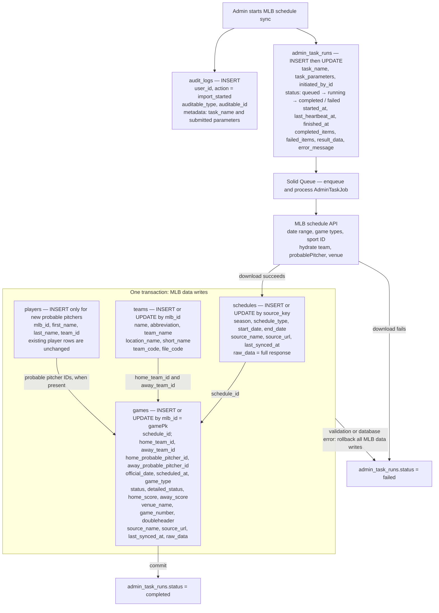

# Admin task: MLB schedule synchronization

Running `mlb_schedule_sync` from the Admin page downloads MLB schedule data for the selected date range, game types, and sport ID. If no end date is supplied, it uses the start date. The default game types are `R,W,D,L,F`, and the default sport ID is `1`.

| Table | Change made by this Admin task |
| --- | --- |
| `audit_logs` | Inserts an `import_started` entry with the task name and submitted parameters when the Admin endpoint is called. This happens before the job is launched, so the entry can exist even if launch or import fails. |
| `admin_task_runs` | Inserts a queued run with parameters and the initiating user; updates it to running and then completed or failed, with timestamps, counts, error text, and the result payload. `total_items` is set to 1 for this task. |
| Solid Queue tables | Enqueuing and processing the `AdminTaskJob` changes queue records, including `solid_queue_jobs` and its execution state tables. These are job infrastructure, not MLB data. |
| `schedules` | Finds or creates one row by `source_key` (`mlb:schedule:<sport_id>:<start_date>:<end_date>:<sorted_game_types>`). Updates season, type, range, source URL, sync time, and the full downloaded JSON in `raw_data`. An empty MLB response still writes this row. |
| `teams` | Finds or creates each home and away team by `mlb_id`, then updates its names, abbreviation, and codes from the hydrated schedule response. |
| `players` | Creates a row for a probable pitcher only when the MLB pitcher ID is new and a usable full name is supplied. The new row gets the home or away team. Existing player rows are left unchanged. Missing probable pitchers create no row. |
| `games` | Finds or creates each game by MLB `gamePk` (`mlb_id`). Updates the columns shown in the diagram. Game details fields such as `details_last_synced_at`, `boxscore_raw_data`, and `live_feed_raw_data` are not assigned by this task. |

The importer de-duplicates games with the same `gamePk` within one response and writes the last occurrence. A repeat of the same request updates the same schedule and game rows. If a different request range includes an existing game, that game's `schedule_id` is changed to the schedule row for the newer request. The task does not delete games missing from the latest response. A missing probable pitcher or score in the latest response can clear the corresponding game column to `NULL`. Venue data is stored on `games.venue_name` and in raw JSON; there is no `venues` table write.

Rails also sets `created_at` on new rows and refreshes `updated_at` when a saved row changes. All `schedules`, `teams`, `players`, and `games` writes occur in one transaction. A validation or database error rolls back those four tables for that import, while the Admin task run records the failure.

## Code references

- Admin entry and audit: `app/controllers/api/admin/tasks_controller.rb`
- Run tracking and job: `app/services/admin_task_launcher.rb`, `app/jobs/admin_task_job.rb`
- Task selection: `app/services/admin_task_runner.rb`
- Download and import: `app/services/mlb_schedule_sync.rb`, `app/services/mlb_schedule_downloader.rb`, `app/services/mlb_schedule_importer.rb`
