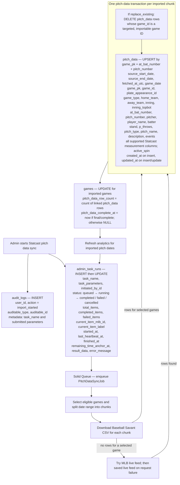
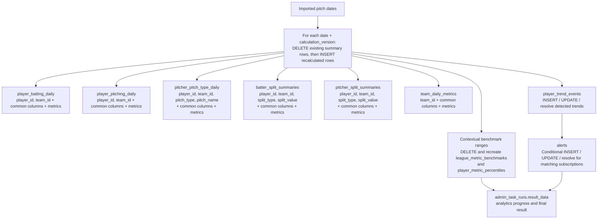

# Admin task: Statcast pitch data synchronization

`pitch_data_sync` operates on **stored** games in the selected inclusive date range and game types. It excludes cancelled games and unplayed conditional postseason games. By default it skips games with `pitch_data_complete_at` set, except games still marked `live`; `replace_existing` selects all matching games. The default game types are `R,W,D,L,F`. No `games`, `players`, or `plate_appearances` rows are created by this task.

## Download and direct database writes

The importer validates that each row has `game_pk`, `at_bat_number`, and `pitch_number`, de-duplicates those identities within the chunk, links `game_id` by `games.mlb_id`, and links `plate_appearance_id` when the matching plate appearance already exists. It converts supported CSV fields to database types. `active_spin` comes from `active_spin` or `spin_efficiency`. An MLB live-feed fallback supplies a smaller subset of pitch columns; its `raw_live_feed_event` key is not a database column and is not stored. Missing source fields become `NULL` on an upsert.

The importer accepts every other current `pitch_data` column by matching its name to a source field. These additional Statcast columns are:

| Group | Columns populated from matching source fields when present |
| --- | --- |
| Count, movement, contact, and score | `balls`, `strikes`, `outs_when_up`, `release_speed`, `release_spin_rate`, `release_extension`, `release_pos_x`, `release_pos_y`, `release_pos_z`, `pfx_x`, `pfx_z`, `plate_x`, `plate_z`, `zone`, `launch_speed`, `launch_angle`, `hit_distance_sc`, `bb_type`, `estimated_ba_using_speedangle`, `estimated_woba_using_speedangle`, `woba_value`, `delta_run_exp`, `bat_score`, `fld_score`, `post_bat_score`, `post_fld_score`, `sv_id` |
| Other supported Statcast fields | `age_bat`, `age_bat_legacy`, `age_pit`, `age_pit_legacy`, `api_break_x_arm`, `api_break_x_batter_in`, `api_break_z_with_gravity`, `arm_angle`, `attack_angle`, `attack_direction`, `away_score`, `ax`, `ay`, `az`, `babip_value`, `bat_score_diff`, `bat_speed`, `bat_win_exp`, `batter_days_since_prev_game`, `batter_days_until_next_game`, `break_angle_deprecated`, `break_length_deprecated`, `delta_home_win_exp`, `delta_pitcher_run_exp`, `des`, `effective_speed`, `estimated_slg_using_speedangle`, `fielder_2`, `fielder_3`, `fielder_4`, `fielder_5`, `fielder_6`, `fielder_7`, `fielder_8`, `fielder_9`, `game_year`, `hc_x`, `hc_y`, `hit_location`, `home_score`, `home_score_diff`, `home_win_exp`, `hyper_speed`, `if_fielding_alignment`, `intercept_ball_minus_batter_pos_x_inches`, `intercept_ball_minus_batter_pos_y_inches`, `iso_value`, `launch_speed_angle`, `miss_distance`, `n_priorpa_thisgame_player_at_bat`, `n_thruorder_pitcher`, `of_fielding_alignment`, `on_1b`, `on_2b`, `on_3b`, `pitcher_days_since_prev_game`, `pitcher_days_until_next_game`, `post_away_score`, `post_home_score`, `spin_axis`, `spin_dir`, `spin_rate_deprecated`, `swing_length`, `swing_path_tilt`, `sz_bot`, `sz_top`, `tfs_deprecated`, `tfs_zulu_deprecated`, `type`, `umpire`, `vx0`, `vy0`, `vz0`, `woba_denom` |

Deleting existing pitches and upserting their replacements are one transaction **per chunk**. The later `games` coverage update is separate. A failed chunk does not roll back earlier chunks. A selected game with no rows is marked failed for progress and has no pitch or coverage write. The task can still finish as completed when some chunks fail but at least one imports rows; inspect `admin_task_runs.result_data.errors` for partial failures. The Admin audit row is inserted before launch, so it can remain even if launch fails.

## Automatic downstream analytics

After all chunks, imported pitch dates go through `DailyAnalyticsRefresh`. This refresh is separate from the pitch import and runs even after a cancellation if earlier chunks imported rows. It can fail without undoing imported pitches. No analytics writes occur when no imported row has a game date.

All six daily summary tables populate `metric_date`, `source_start_date`, `source_end_date`, `sample_size`, `calculation_version`, `calculated_at`, `source_name`, `metrics`, `created_at`, and `updated_at`, plus the table-specific identity columns shown above. `metrics` is the calculated-statistics JSON. The refresh replaces all rows for each processed date and version, including deleting old rows when a recalculation produces none.

Contextual benchmarks run by default for year-to-date and recent 7-, 14-, and 30-day windows based on stored summary dates. For each range and version, the service deletes old `player_metric_percentiles` and `league_metric_benchmarks` rows, then recreates them:

| Table | Columns populated on new rows |
| --- | --- |
| `league_metric_benchmarks` | `metric_key`, `metric_group`, `display_name`, `peer_group_type`, `peer_group_key`, `dimension_type`, `dimension_value`, `directionality`, `average_value`, `sample_size`, `player_count`, `source_start_date`, `source_end_date`, `calculation_version`, `calculated_at`, `source_name`, `metadata`, `created_at`, `updated_at` |
| `player_metric_percentiles` | `player_id`, `league_metric_benchmark_id`, `raw_value`, `percentile`, `sample_size`, `peer_player_count`, `source_start_date`, `source_end_date`, `calculation_version`, `calculated_at`, `source_name`, `metadata`, `created_at`, `updated_at` |

Trend detection reads stored pitches for players represented on imported dates. It may insert or update `player_trend_events` (identity, metric, baseline/current values and dates, sample sizes, thresholds, evidence, status, detection/observation times), and may insert/update or resolve `alerts` for matching subscriptions. These writes depend on the pitch data and configured subscriptions. The detailed trend and alert column list is also documented in [MLB game detail synchronization](admin_task_mlb_game_details_sync.md#automatic-downstream-writes).

## Code references

- Admin launch and progress: `app/controllers/api/admin/task_runs_controller.rb`, `app/controllers/api/admin/tasks_controller.rb`, `app/services/pitch_data_sync_task_launcher.rb`, `app/jobs/pitch_data_sync_job.rb`, `app/services/pitch_data_sync_progress_tracker.rb`
- Selection, download, import: `app/services/pitch_data_batch_sync.rb`, `app/services/pitch_data_downloader.rb`, `app/services/mlb_live_pitch_data_downloader.rb`, `app/services/pitch_data_importer.rb`
- Derived data: `app/services/daily_analytics_refresh.rb`, `app/services/daily_analytics_calculator.rb`, `app/services/contextual_benchmark_refresh.rb`, `app/services/player_trend_event_refresh.rb`
